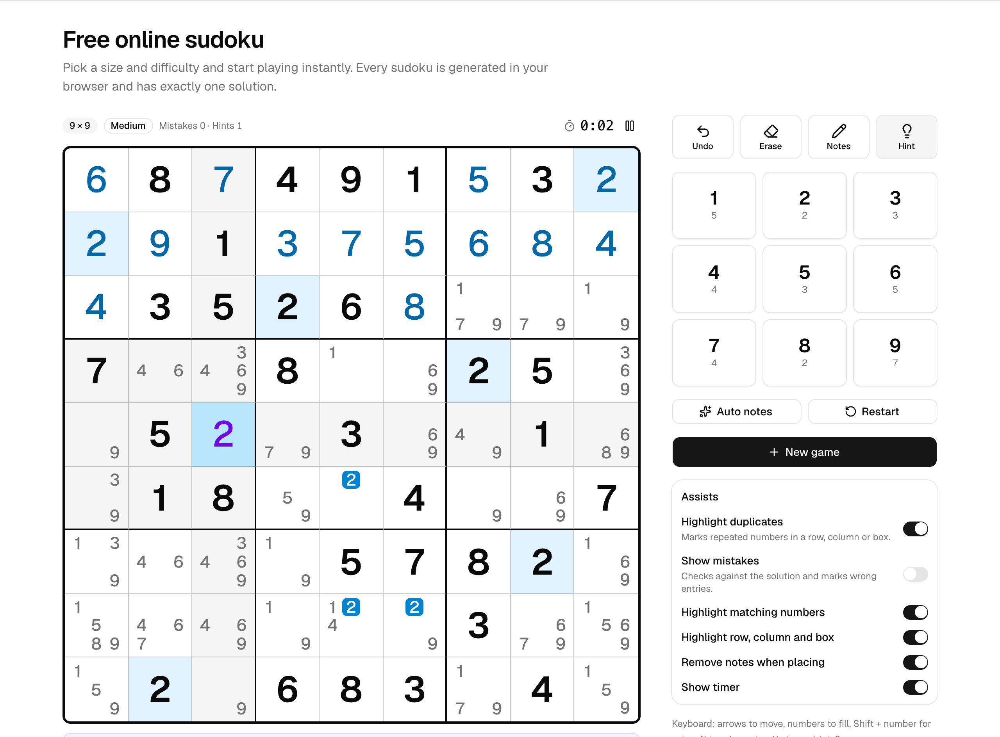
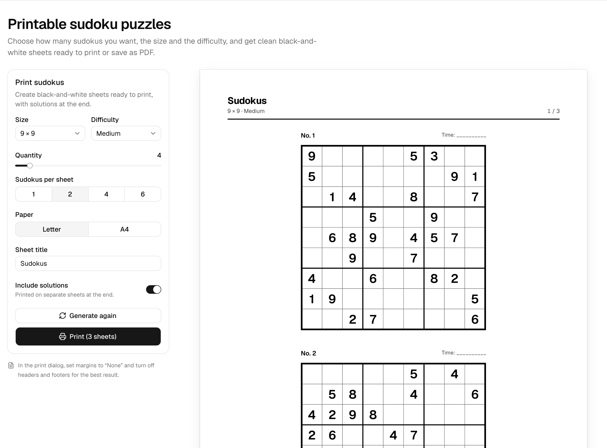

# Sudoku

**Free sudoku generator to play online or print in black and white.** Built with Astro, React, Tailwind CSS and shadcn/ui. No backend, no accounts, no API keys: everything runs in your browser.

🌐 **[sudoku.adal.dev](https://sudoku.adal.dev)** · Español: [/](https://sudoku.adal.dev/) · English: [/en/](https://sudoku.adal.dev/en/)



## Features

### Play online
- Board sizes **4×4, 6×6, 8×8, 9×9 and 12×12** (12×12 uses A–C for 10–12).
- Four difficulty levels: **easy, medium, hard and expert**.
- Notes (manual and automatic), unlimited undo, erase and restart.
- **Explained hints**: "In this box, 7 can only go in this cell". If you have a mistake, the hint fixes it first.
- **Highlight duplicates**, show mistakes against the solution, highlight matching numbers and the selected row/column/box.
- Timer with pause (auto-pauses when you switch tabs), personal best times.
- Progress saved automatically in `localStorage`.
- Full keyboard support, mobile friendly, dark mode.

### Print


- 1 to 36 puzzles, **1, 2, 4, 6 or 9 per sheet**, Letter or A4.
- Crisp SVG grids in black and white, with puzzle number and a time field.
- Optional answer keys on separate, compact pages (starting clues in bold).

### Spanish and English
Spanish is the default locale (`/`, `/imprimir/`) and English lives under `/en/` (`/en/`, `/en/print/`).

## How puzzles are generated

The engine lives in [`src/lib/sudoku`](src/lib/sudoku) and runs inside a Web Worker.

1. **Full solution**: randomized backtracking with bitmasks and the MRV heuristic (fewest candidates first).
2. **Digging**: clues are removed (in symmetric pairs, except for expert) and after every removal a solver checks the puzzle **still has exactly one solution**.
3. **Grading**: a logic solver that only uses human techniques works through the puzzle and records the hardest step it needed:

   | Level | Techniques |
   |-------|------------|
   | 1 | Naked single, hidden single |
   | 2 | Locked candidates (pointing / claiming) |
   | 3 | Naked pairs, hidden pairs, naked triples |
   | 4 | Hidden triples, X-Wing, Y-Wing, Swordfish |

4. **Targeting**: generation repeats until the puzzle falls in the requested range:
   - **Easy**: singles only, many clues.
   - **Medium**: up to locked candidates.
   - **Hard**: requires locked candidates, pairs or triples.
   - **Expert**: requires level 4 techniques, yet is **always solvable without guessing**.

A 9×9 expert puzzle typically takes under 50 ms; 12×12 expert around 0.5 s.

## Getting started

Requires Node.js 22+.

```sh
npm install
npm run dev
```

| Command | Description |
|---------|-------------|
| `npm run dev` | Start the dev server at `localhost:4321` |
| `npm run build` | Build the static site into `dist/` |
| `npm run preview` | Preview the production build |
| `npm run check` | Type-check the project |
| `npm run bench` | Benchmark generation and verify uniqueness for every size and difficulty |
| `npm run verify` | Check that the logic solver never eliminates a correct value |
| `npm run deploy` | Build and deploy to Cloudflare Workers (static assets) |

The production URL defaults to `https://sudoku.adal.dev`. Override it with `SITE_URL` when building for another domain:

```sh
SITE_URL=https://your-domain.com npm run build
```

## Deployment

The site is deployed to **Cloudflare Workers** as static assets ([`wrangler.jsonc`](wrangler.jsonc)) with `sudoku.adal.dev` as a custom domain. [`public/_headers`](public/_headers) sets long-lived caching for hashed assets and basic security headers.

```sh
npx wrangler login
npm run deploy
```

To deploy under your own domain, change `routes` in `wrangler.jsonc` and build with `SITE_URL`.

## SEO

- Server-rendered content (H1, guide, difficulty levels, FAQ) below each app.
- Canonical + `hreflang` (es, en, x-default) on every page and in the sitemap.
- Open Graph and Twitter cards with a localized image per language.
- JSON-LD: `WebSite`, `WebApplication`, `WebPage`, `BreadcrumbList`.
- `sitemap-index.xml`, `robots.txt`, `llms.txt` and a web manifest.

## Project structure

```
src/
├── components/
│   ├── print/        Print studio and SVG grid
│   ├── seo/          Page shells and indexable content
│   ├── sudoku/       Game, board, number pad, selects
│   └── ui/           shadcn/ui components
├── i18n/             UI strings and page content (es, en)
├── layouts/          Base layout with meta tags and JSON-LD
├── lib/sudoku/       Generator, solvers, grader, game reducer, worker
└── pages/            Routes, robots.txt and llms.txt
```

## Contributing

Issues and pull requests are welcome. Please run `npm run check` and `npm run verify` before submitting.

## Author

Made by **Adal** · [@adalcodes](https://x.com/adalcodes)

## License

[MIT](LICENSE)

---

### Español

Generador de sudokus gratis para jugar en línea o imprimir en blanco y negro. Tableros de 4×4 a 12×12, cuatro niveles de dificultad calificados con técnicas humanas, solución única garantizada, pistas explicadas, notas, cronómetro y progreso guardado en el navegador. Disponible en español e inglés en [sudoku.adal.dev](https://sudoku.adal.dev).
